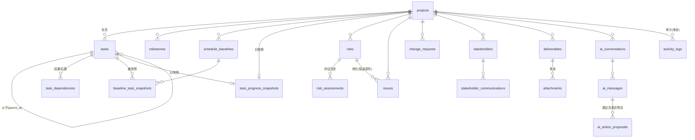

# 04 · 数据库设计与字段字典

> 交付物对应：阶段 0 要求的「5. 数据库 ER 图和字段字典」
> 依据：方案·四「数据库设计」全部 20 张数据表 + 五条业务规则的落地设计。
> 方案原文："不需要在第一天就把每张表都实现完，但数据结构应允许后续平滑增加这些能力。" —— 各表实施批次见第 6 节。

---

## 1. 设计原则

1. **统一数据模型**：所有页面共享同一套业务数据，禁止每个页面单独创建状态（方案·四："建议 Agent 从统一的数据模型开始"）。
2. **业务事实与 AI 建议物理隔离**：AI 产物仅落在 `ai_*` 三表，确认后才经服务层写入业务表（BR-05）。
3. **快照不可变**：`baseline_task_snapshots` 与 `task_progress_snapshots` 为追加型记录，写入后不允许 UPDATE（BR-02/BR-03）。
4. **主键**：UUIDv4（任务 ID 天然满足"稳定的任务 ID"要求）。业务可读编号（项目编号、WBS 编码）为应用层字段。
5. **时间**：时间戳存 `timestamptz`（UTC）；纯日期（计划/实际日期）用 `date`；容器时区 `Asia/Shanghai`（03 文档 4.3）。
6. **软删除**：核心业务表用 `archived_at`（归档语义，项目/风险/问题）或 `deleted_at`；`activity_logs` 保留删除前痕迹。
7. **多态附件**：`attachments` 与 `activity_logs` 通过 `object_type + object_id` 关联任意业务对象。

## 2. ER 关系图（mermaid）

> 渲染提示：Obsidian / GitHub 原生支持 mermaid。`ai_conversations` 引用 `app_settings` 中的模型配置项（逻辑引用，不建外键）。

## 3. 字段字典（20 张表）

### 3.1 `projects`（阶段 1 · T1-05）

| 字段 | 类型 | 约束/默认 | 说明 |
|---|---|---|---|
| id | uuid | PK | |
| code | varchar(32) | NOT NULL，唯一（同 account 内，含归档） | 项目编号（人工输入，重复时报错——阶段1验收） |
| name | varchar(200) | NOT NULL | 项目名称 |
| customer | varchar(200) | | 客户 |
| manager | varchar(100) | | 项目经理 |
| phase | varchar(40) | 枚举可扩展 | 项目阶段（方案·一"阶段"） |
| status | varchar(40) | 枚举 | 状态 |
| plan_start / plan_end | date | plan_end ≥ plan_start（应用校验） | 计划起止 |
| actual_start / actual_end | date | | 实际起止 |
| description | text | | 项目描述（AI 生成 WBS 的上下文来源之一） |
| work_calendar_id | uuid | FK 可空 | 项目级工作日历覆盖；NULL 时使用全局日历（全局定义与项目级例外日期存于 `app_settings`，见 3.20；TD-01） |
| created_at / updated_at | timestamptz | NOT NULL | |
| archived_at | timestamptz | 可空 | 归档（阶段1提示词·条5"归档"） |
| deleted_at | timestamptz | 可空 | 软删除（删除确认后置位；编号不释放——会话 1 实现补充，对应 T1-05 DELETE 端点） |

> 工作日历数据本身（周末定义、节假日、项目级例外日期）统一存 `app_settings.workcalendar.*`（3.20 节），`projects.work_calendar_id` 用于支持项目级独立日历的扩展位；第一版实现全局日历 + 项目级例外日期。

### 3.2 `tasks`（阶段 2 · T2-01）

| 字段 | 类型 | 约束/默认 | 说明 |
|---|---|---|---|
| id | uuid | PK | 稳定任务 ID（永不变，满足阶段2提示词·WBS条3） |
| project_id | uuid | FK→projects，NOT NULL，索引 | |
| parent_id | uuid | FK→tasks 自引用，可空，索引 | 多级父子（WBS条1） |
| sort_order | int | NOT NULL | 同级排序（拖拽排序用） |
| wbs_code | varchar(40) | NOT NULL，应用层重算 | "1.2.3" 编码，增删/排序后全树重算（WBS条3） |
| name | varchar(200) | NOT NULL | 任务名称 |
| owner | varchar(100) | | 负责人（WBS条4） |
| collaborators | jsonb | 默认 `[]` | 协作人员列表 |
| plan_start / plan_end | date | 可空，end≥start（校验） | 计划日期 |
| actual_start / actual_end | date | 实际日期 |
| duration_days | int | 可空 | 工期（按工作日历计算的工作日口径，TD-01；应用层计算存值，另有 `duration_days_raw` 自然日参考——实现见 T2-07） |
| work_hours | numeric(8,2) | 可空 | 工时（进度汇总权重与燃尽图口径来源） |
| progress | numeric(5,2) | 0-100，叶子任务人工录入 | 进度（叶任务为准，父任务汇总——TD-02） |
| status | varchar(30) | NOT NULL | 状态（未开始/进行中/已完成/已取消等） |
| priority | varchar(20) | | 优先级 |
| acceptance_criteria | text | | 验收标准（WBS条4） |
| deliverable_name | text | | 交付物说明（与 `deliverables` 表的资料条目通过名称/关联字段衔接） |
| progress_source | varchar(20) | `manual`/`manual_adjusted` | 是否经过人工校正（TD-02；人工校正时须留 audit 原因） |
| created_at / updated_at / deleted_at | timestamptz | 软删除 |

### 3.3 `task_dependencies`（阶段 2 · T2-01/T2-05）

| 字段 | 类型 | 说明 |
|---|---|---|
| id | uuid PK | |
| project_id | uuid FK，索引 | 冗余存项目便于校验范围 |
| predecessor_id / successor_id | uuid FK→tasks | 前置/后置任务（方案·四原文） |
| dep_type | varchar(20) | FS（完成-开始，第一版默认）/ SS / FF / SF（`cascade` 支持程度见 D-05） |
| lag_days | int | 时滞（方案·四原文） |
| | | 唯一约束：(predecessor_id, successor_id, dep_type)；同项目内环校验在服务层（DFS），违反即拒绝（阶段2验收"依赖循环被拒绝"） |

### 3.4 `milestones`（阶段 2 · T2-01）

> 字段：id, project_id(FK), name, plan_date(date), actual_date(date), status(varchar), description。甘特图里程碑渲染（阶段2提示词·甘特条2）读此表。

### 3.5 `schedule_baselines`（阶段 2 · T2-13）

> 字段：id, project_id(FK), name(基线名称), version(int), frozen_at(timestamptz), note。保存后该版本记录不允许修改（BR-02）。

### 3.6 `baseline_task_snapshots`（阶段 2 · T2-13）

> 字段：id, baseline_id(FK), task_id(FK), level/sort/wbs_code/name 快照值, plan_start, plan_end, duration_days, work_hours, progress_snapshot numeric, taken_at。
> 基线对比视图 = 当前 `tasks` 与所选 baseline 的本表逐字段 diff（甘特要求6"允许比较基线与当前计划"）。

### 3.7 `task_progress_snapshots`（阶段 5 · T5-01）

| 字段 | 类型 | 说明 |
|---|---|---|
| id, project_id(FK 可空), task_id(FK 可空) | uuid | 项目级快照 task_id 为 NULL 行；任务级反之（方案·四："任务或项目在特定日期"） |
| snapshot_date | date + 归一化唯一约束 (project_id, scope, snapshot_date) | 每对象每天至多一条（scope=project/task） |
| remaining_work_hours / remaining_tasks / completed_tasks / total_hours / total_tasks | numeric/int | 剩余工时、剩余任务量及完成量（方案·四原文）；燃尽图唯一数据源（BR-03："不得编造过去的数据"——无记录的日期不生成曲线点） |
| captured_at | timestamptz | 采集时间 |

### 3.8 `risks`（阶段 3 · T3-04）

> 字段：id, project_id(FK), category(varchar), description(text), probability(int 1-5), impact(int 1-5), score(int=probability×impact), level(varchar，由 `app_settings` 评分矩阵映射，可配置——FR-P0-20), owner, trigger_condition(text 预防触发), prevention(text 预防措施), contingency(text 应急措施), strategy(varchar 规避/转移/减轻/接受), status(varchar 打开/已发生/已关闭/已转问题/已转任务), residual_level(varchar 剩余风险), created/updated/archived_at。
> **状态机约束**：转化为 issue/task 后 `risk_id` 由转化目标回链，原风险记录永不删除（BR-04）。

### 3.9 `risk_assessments`（阶段 3 · T3-05）

> 字段：id, risk_id(FK), probability, impact, score, level, assessed_at, basis(text 评估依据——方案·四原文)。追加型：每次评估插入新行，历史不可改。

### 3.10 `issues`（阶段 3 · T3-07）

> 字段：id, project_id(FK), risk_id(FK 可空——从风险转化而来，保留关联), title, detail(text 影响), severity(varchar), owner, due_date(date 要求解决时间), root_cause(text 原因分析), action_taken(text 处理措施), verified_at(timestamptz 验证结果时间), verified_by, **closure_result(text NOT NULL at close)** —— 状态流转到"已关闭"时强制必填（阶段3验收"关闭问题需要填写解决结果"）。

### 3.11 `change_requests`（阶段 3 · T3-09）

> 字段：id, project_id(FK), title, origin(text 变更原因), scope_impact(text), schedule_impact(text), cost_impact 可空, approval_status(varchar 草拟/审批中/批准/驳回/实施中), implementation_plan(text), verification_result(text), 审批人/审批时间，created/updated_at。

### 3.12 `stakeholders`（阶段 3 · T3-02，P1）

> 字段：id, project_id(FK), person_type(person/org), name, org(单位), role(角色), influence(int 1-5 影响力), interest(int 1-5 关注程度), demands(text 诉求), strategy(text 沟通策略), comm_frequency(varchar 沟通频率), latest_reminder_date(date 提醒日期——方案·四 `stakeholder_communications` 后续行动；提醒视图读取)。

### 3.13 `stakeholder_communications`（阶段 3 · T3-03，P1）

> 字段：id, stakeholder_id(FK), comm_date(date 沟通时间), channel, content(text 沟通内容), conclusion(text 结论), follow_up_action(text 后续行动), follow_up_date, next_reminder_date。

### 3.14 `deliverables`（阶段 5 · T5-03/T5-04，P1）

> 字段：id, project_id(FK), template_id(FK 可空→`app_settings` 模板), category(设备到货/安装调试/测试/培训/试运行/验收/运维移交，FR-P1-05), name, owner, plan_date(date), submit_status(varchar 提交状态), review_status(varchar 审核状态), note, task_id(FK 可空——关联 `tasks.deliverable_name`)。

### 3.15 `attachments`（阶段 5 · T5-05，P1）

> 字段：id, object_type+object_id(多态), file_name, storage_path(相对 `./data/attachments`), size_bytes, mime_type, sha256(完整性), uploaded_at。附件删除：仅删 attachments 行与文件引用计数，不级联删业务对象。

### 3.16 `ai_conversations`（阶段 4 · T4-01）

> 字段：id, project_id(FK 可空), title, model_setting_key(引用 app_settings 中模型配置的逻辑名), created_at。

### 3.17 `ai_messages`（阶段 4 · T4-01/T4-12）

> 字段：id, conversation_id(FK), role(user/assistant/system), content(text), call_status(varchar：pending/succeeded/timeout/format_error/api_error), model_identifier(varchar), context_digest(jsonb：本次实际发送的字段范围——TD-03 数据最小化依据与发送范围说明), token_usage 可空, created_at。**日志与消息中永不落完整密钥**（NFR-05）。

### 3.18 `ai_action_proposals`（阶段 4 · T4-05）

| 字段 | 说明 |
|---|---|
| id, message_id(FK) | |
| action_type | `wbs_draft` / `task_update` / `risk_note` / `report_draft` / `deliverable_check` |
| payload(jsonb) | 经校验的结构化参数（任务名/日期/负责人/依赖引用——非法值在入库前被校验层拒绝，阶段4验收） |
| diff_preview(jsonb) | 新增/修改/删除三类差异（"展示新增、修改和删除的差异"——方案·阶段4） |
| status | `pending` / `accepted`（含 accepted_by/at）/ `rejected` / `expired` |
| applied_at | 写入业务表的时间；**only accepted → 服务层才写业务表**（BR-05） |

### 3.19 `activity_logs`（阶段 3 · T3-10）

> 字段：id, object_type+object_id(多态), action(varchar：create/update/archive/delete/accept_ai/reject_ai/correct_progress…), summary(text 变更摘要——方案·四原文), payload_diff(jsonb 可空), operator(第一版恒为 owner)，occurred_at。覆盖：关键操作写入审计（阶段3通用要求）；人工校正进度记录原因（TD-02）；AI 确认动作（方案·阶段4"记录 AI 调用状态、生成时间、模型标识和人工确认结果"）。

### 3.20 `app_settings`（阶段 1 建 · T1-10；各阶段填充配置项）

| 配置键（category+key） | 用途 | 首次使用 |
|---|---|---|
| `model.default` | 排名第一的模型：Provider（OpenAI 兼容）/ API base / model / api_key（仅服务端）/ timeout | 阶段4 |
| `model.alternates` | 备用与未来的本地模型 | 阶段4+ |
| `workcalendar.overrides` | 全局工作日历：周末定义 + 节假日 | 阶段2 |
| `workcalendar.project.<id>.exceptions` | 项目级例外日期（TD-01） | 阶段2 |
| `risk.matrix` | 概率×影响→等级映射 + 高/中/低阈值（可配置评分，FR-P0-20） | 阶段3 |
| `progress.rule` | 汇总算法参数（工时优先/等权重回退，D-04） | 阶段2 |
| `snapshot.policy` | 进度快照采集策略（每日首次写入/手动） | 阶段5 |
| `deliverable.templates` | 交付清单模板（FR-P1-05） | 阶段5 |
| `report.templates` | Word 报告模板引用 | 阶段5 |

> 结构：key(varchar 唯一+目录式), value(jsonb), description, updated_at。api_key 类字段加密存储，查询接口永不回传（NFR-05/08）。

## 4. 关键设计决策

| 编号 | 决策 | 依据 |
|---|---|---|
| DM-1 | 任务树用 `parent_id` 自引用 + `sort_order`，不引入 ltree（第一版任务量级小，递归 CTE 足够） | 方案数据量级（个人项目管理） |
| DM-2 | WBS 编码存列、全树重算；UUID 主键不受排序影响（"稳定任务 ID"） | 阶段2提示词 WBS条3 |
| DM-3 | 父任务不存 progress 权威值——查询时按 `progress.rule` 现算（或物化触发器同步），避免双源；实现在 T2-06 定案 | TD-02 |
| DM-4 | 依赖环校验在服务层做（写路径统一校验），数据库只留唯一约束 | 阶段2验收"依赖循环被拒绝" |
| DM-5 | 快照表只 INSERT；`update/delete` 由应用层禁止（服务层守卫 + 测试） | BR-02/BR-03 |
| DM-6 | 附件去重用 sha256，重复文件复用 storage_path | 存储成本 |
| DM-7 | 多态关联不加 DB 外键，一致性由服务层保证（attachments/logs 的 object_type 白名单校验） | PostgreSQL 多态外键不支持，明确取舍 |

## 5. 索引与性能基线

- 常用列表查询走 `(project_id, sort_order)`、`(project_id, snapshot_date)`、`(object_type, object_id)` 组合索引；project.code 唯一索引。
- 数据量级假设：项目数 <100、任务数 <5000/项目（含层级）、快照 ≤ 1 行/对象/天 —— 该量级下 PG 单机 + 常规索引即满足响应要求（方案未定义性能阈值，**此假设为待确认项，如实际量级更高再评估**）。

## 6. 各表实施批次映射

| 阶段 | 新增表 | 对应任务 |
|---|---|---|
| 1 | projects、app_settings（骨架） | T1-05/T1-10 |
| 2 | tasks、task_dependencies、milestones、schedule_baselines、baseline_task_snapshots | T2-01、T2-13 |
| 3 | risks、risk_assessments、issues、change_requests、stakeholders、stakeholder_communications、activity_logs | T3-01、T3-10 |
| 4 | ai_conversations、ai_messages、ai_action_proposals | T4-01 |
| 5 | deliverables、attachments、task_progress_snapshots | T5-01、T5-03、T5-05 |

每阶段迁移文件只增不改历史链（Alembic 前进式），满足"数据库迁移能够从空库执行"（NFR-11）与"备份文件可以在干净环境恢复"（NFR-12）。
